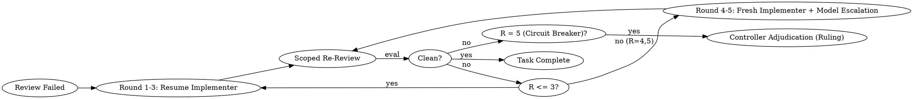

# Two-Track Review and Escalating Fix Loop Protocols

Internal Andino resource for `andino-delegation`. Operates under Andino Workflow governance.

## 1. Two-Track Review Architecture

A robust review gate must evaluate two orthogonal dimensions independently:

```
Task Diff Ready:
├── Track 1: Spec Compliance (Binding Contract)
│   ├── PASS (Spec Compliant): Exact criteria met, nothing unrequested built.
│   ├── FAIL (Issues Found): Requirements missing, extra features (YAGNI), or misunderstood intent.
│   └── UNVERIFIED (Cannot Verify): Invariants dependent on external/cross-task state.
└── Track 2: Code Quality (Craft & Maintainability)
    ├── Approved: Clean separation, robust error handling, authentic behavioral tests.
    └── Needs Fixes: Fragile abstractions, mock-only tests, unhandled edge cases.
```

### Triaging Findings: Halting Reviewer Churn

To eliminate token thrashing and endless stylistic loops, findings are classified into 3 strict tiers:

| Severity | Definition | Handling Protocol |
| :--- | :--- | :--- |
| **Critical** | Spec contradiction, security flaw, data corruption, or broken public contract. | **Enters Fix Loop immediately.** Blocks task completion. |
| **Important** | Fragile logic, unhandled edge case, brittle test assertion, or severe maintainability hazard. | **Enters Fix Loop immediately.** Blocks task completion. |
| **Minor (Deferred)** | Naming preferences, cosmetic formatting, comment suggestions, or micro-optimizations. | **Bypasses Fix Loop entirely.** Appended to progress ledger as `Task <N>: minor (deferred): <finding>` for post-plan triage. |

---

## 2. Scoped Diff Packaging (`review-package`)

Reviewers must never be directed to perform broad filesystem explorations or execute ad-hoc git commands.

### Mechanics
Before dispatching a task reviewer or re-reviewer, the controller captures the exact commit range:
1. **BASE**: The commit recorded immediately prior to dispatching the implementer (`git rev-parse HEAD`).
2. **HEAD**: The current commit after implementation (`git rev-parse HEAD`).
3. Package Generation: Write commit log, stat summary, and unified diff (`-U10`) to an isolated diff package on disk:
   `.andino/delegation/<plan-id>/review-<base7>..<head7>.diff`
4. The reviewer reads this file in a single tool call, preserving parent context.

---

## 3. The 5-Round Escalating Fix Loop

When Track 1 reports FAIL or Track 2 identifies Critical/Important issues, the fix loop initiates:



### Round 1–3: Resume Original Implementer
- The original implementer maintains working context, active variable mappings, and understanding of its previous edits.
- Pass open Critical/Important findings verbatim.
- The implementer applies targeted fixes, re-runs covering tests, appends its fix report, and returns the short status contract.

### Round 4–5: Fresh Implementer & Model Escalation
- A model stuck for 3 rounds suffers from cognitive anchoring (*confirmation bias*).
- Dispatch a **fresh implementer** with zero conversational baggage.
- **Escalate One Step**: Move one tier up (Fast -> Standard -> Capable) OR one effort step up, never both at once, and announce it to the user first. Map tiers with [host-cost-calibration.md](host-cost-calibration.md).
- Brief specifies: *"A previous implementer attempted this task 3 times and stalled. You own the clean resolution. Read the report file to see previous attempts."*

### Scoped Re-Review Gate
- Re-reviews are strictly diff-scoped (`FIX_BASE..HEAD`).
- The re-reviewer evaluates only whether previously opened findings are `ADDRESSED` or `NOT ADDRESSED` and checks for regressions introduced by the fix itself.
- New out-of-scope nitpicks are relegated to deferred minors and cannot extend the loop.

---

## 4. Circuit Breaker (Rule of 5) & Rulings Taxonomy

If round 5 concludes with findings still open, the fix loop **terminates immediately**. The parent controller trips the circuit breaker and adjudicates.

### Adjudication Categories & Rulings Format
The controller examines the full brief, diff, and review history, logging one of three explicit rulings in the progress ledger:

1. **Reviewer Overreach (False Positive)**:
   - When the reviewer is being pedantic or the design choice is valid:
   - `Task <N>: parked — <finding> — Ruling: code stands — <rationale> — Cost if wrong: <risk>`
2. **Real but Non-Blocking (Deferred Debt)**:
   - When the defect is real but no downstream task depends on it:
   - `Task <N>: parked — <finding> — Ruling: deferred to post-release — <rationale> — Cost if wrong: <risk>`
3. **Load-Bearing Structural Gap (Plan Defect)**:
   - When a downstream task depends on the broken interface:
   - `Task <N>: Ruling: structural adjustment — <decision> — <corrective interface contract>`
   - The ruling is injected directly into the next task's brief.

### Hard Rule on Controller Discipline
The controller **never writes production code fixes directly** inside its coordination session. Fixing code inline pollutes coordinator context, skips verification gates, and destroys auditability.
